<picture>
  <source media="(prefers-color-scheme: dark)" srcset="assets/header-dark.svg">
  
</picture>

<div align="center">

<a href="https://zhmdff.com"><picture><source media="(prefers-color-scheme: dark)" srcset="assets/link-web-dark.svg"></picture></a>
<a href="https://linkedin.com/in/zhmdff/"><picture><source media="(prefers-color-scheme: dark)" srcset="assets/link-linkedin-dark.svg">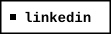</picture></a>
<a href="https://twitter.com/zhmdff"><picture><source media="(prefers-color-scheme: dark)" srcset="assets/link-twitter-dark.svg">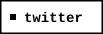</picture></a>
<a href="https://instagram.com/zhmdff"><picture><source media="(prefers-color-scheme: dark)" srcset="assets/link-instagram-dark.svg">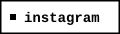</picture></a>
<a href="mailto:zhmdff@gmail.com"><picture><source media="(prefers-color-scheme: dark)" srcset="assets/link-email-dark.svg">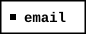</picture></a>

</div>

<br/>

<picture>
  <source media="(prefers-color-scheme: dark)" srcset="assets/section-00-dark.svg">
  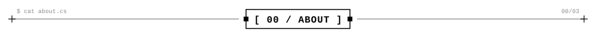
</picture>

<table>
<tr>
<td width="58%" valign="top">

```csharp
public class Developer
{
    public string   Name   => "Mahmud Ahmadov";
    public string   Handle => "@zhmdff";
    public string[] Roles  => [
        "Backend Architect",
        "Systems Developer",
        "Game Dev"
    ];
    public string CurrentFocus =>
        "Web backends and game systems, mostly in C#.";
}
```

</td>
<td width="42%" valign="top">

| key        | value                               |
| :--------- | :---------------------------------- |
| `location` | Baku, Azerbaijan                    |
| `core`     | C# · .NET                           |
| `focus`    | system design, security, automation |
| `builds`   | web backends, game systems          |
| `status`   | open to collaboration               |

</td>
</tr>
</table>

<picture>
  <source media="(prefers-color-scheme: dark)" srcset="assets/section-01-dark.svg">
  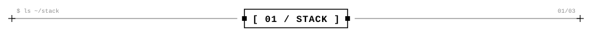
</picture>

<picture>
  <source media="(prefers-color-scheme: dark)" srcset="assets/stack-dark.svg">
  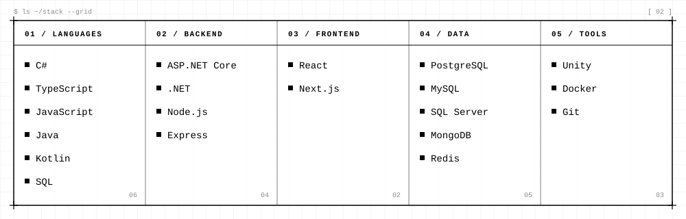
</picture>

<picture>
  <source media="(prefers-color-scheme: dark)" srcset="assets/section-02-dark.svg">
  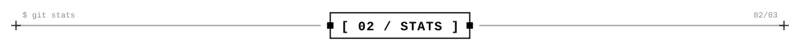
</picture>

<div align="center">

<picture>
  <source media="(prefers-color-scheme: dark)" srcset="https://github-readme-stats.vercel.app/api?username=zhmdff&show_icons=true&include_all_commits=true&count_private=true&bg_color=000000&title_color=ffffff&text_color=ffffff&icon_color=ffffff&border_color=ffffff&border_radius=0&custom_title=$%20git%20stats">
  
</picture>
<picture>
  <source media="(prefers-color-scheme: dark)" srcset="https://streak-stats.demolab.com?user=zhmdff&background=000000&border=FFFFFF&stroke=FFFFFF&ring=FFFFFF&fire=FFFFFF&currStreakNum=FFFFFF&sideNums=FFFFFF&currStreakLabel=FFFFFF&sideLabels=FFFFFF&dates=9E9E9E&border_radius=0">
  
</picture>

</div>

<picture>
  <source media="(prefers-color-scheme: dark)" srcset="assets/section-03-dark.svg">
  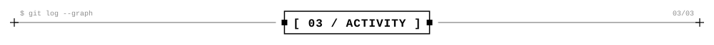
</picture>

<picture>
  <source media="(prefers-color-scheme: dark)" srcset="assets/activity-dark.svg">
  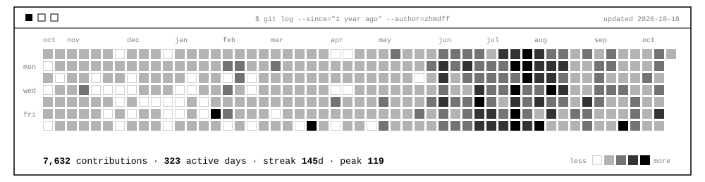
</picture>

<picture>
  <source media="(prefers-color-scheme: dark)" srcset="assets/footer-dark.svg">
  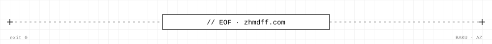
</picture>
